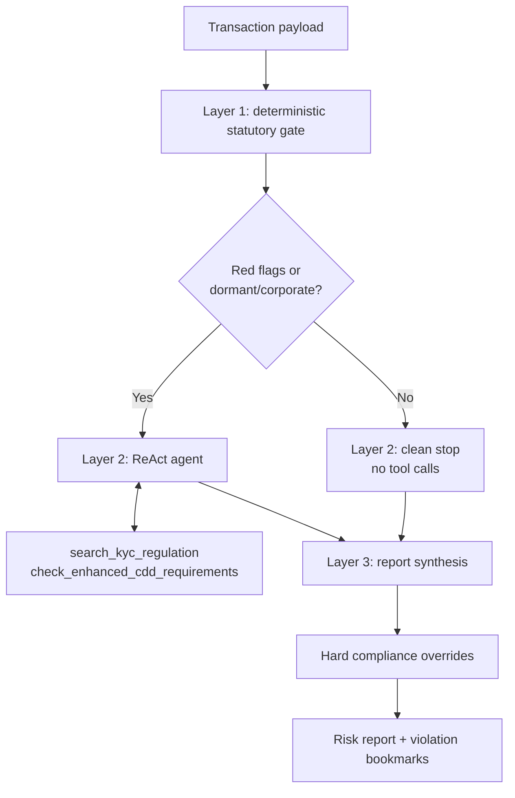

# 3-Layer Guardrailed Hybrid KYC/AML Compliance Agent

An autonomous yet deterministically guardrailed **anti-money-laundering (AML)**
and **know-your-customer (KYC)** transaction-triage system for Hong Kong banking
corridors (SWIFT, CHATS/RTGS and FPS).

The application combines a **LangGraph** state machine, a **NiceGUI** web
interface, **Pydantic** structured output, and a fully local
**Qwen2.5-3B-Instruct (GGUF)** model served through `llama-cpp-python`. No paid
LLM API keys and no runtime dataset downloads are required.

> **Demonstration software.** It is not a production compliance system, not
> legal advice, and must not be used to process real customer data.

---

## Architecture



### Layer 1 — mandatory statutory gate (deterministic Python)

Runs before any model call, so it can never be skipped or hallucinated away.
Every rule is evaluated and recorded, whether triggered or not.

| Reference ID | Rule | Trigger | Severity |
|---|---|---|---|
| `UN-OFAC-SANCTIONS` | UN / OFAC / EU sanctions screening of both remitting and beneficiary banks against the bundled OpenSanctions feed | Name match on either side | `CRITICAL` |
| `FATF-R19` | FATF Recommendation 19 high-risk jurisdiction check across both account profiles | Iran, Myanmar, Vietnam, Syria, Russia, North Korea | `HIGH` |
| `HKMA-AMLO-120K` | HKMA AMLO customer due diligence threshold (Cap. 615) | Amount above HKD 120,000 | `HIGH` |
| `HKMA-DORMANT-50K` | Dormant account reactivation monitoring | Dormant account and amount above HKD 50,000 | `HIGH` |

### Layer 2 — autonomous AI detective (LangGraph ReAct loop)

A local Qwen2.5-3B model decides whether the Layer 1 findings warrant deeper
investigation.

- **Clean path** — if every Layer 1 rule passed and no account is dormant or
  corporate, the agent answers `LAYER2_CLEAN_STOP` without calling a tool.
- **Investigation path** — otherwise it must call both tools before finishing:
  - `check_enhanced_cdd_requirements` returns HKMA AML/CFT Guideline Section 4
    enhanced due diligence requirements.
  - `search_kyc_regulation` performs lexical retrieval over the FinCEN
    customer due diligence corpus and returns the two best-matching clauses.

Tool output is captured verbatim in the trace shown in the UI.

### Layer 3 — guardrail synthesis and hard overrides

The model produces a structured `RiskReport` (overall tier, violation items,
recommended action). Deterministic guardrails are then applied on top:

- Violations citing an unknown reference ID are discarded.
- Any `UN-OFAC-SANCTIONS` hit forces `overall_risk = CRITICAL`.
- Any triggered Layer 1 rule with a model-reported `LOW` tier is raised to
  `HIGH`.
- With no triggers and no tool trace, a fixed `LOW` report is returned without
  calling the model at all.

---

## Requirements

- Python 3.10–3.12 (64-bit)
- ~2 GB of disk for the quantised model, plus the 18 MB data archive
- No GPU required; CPU inference is supported

## Quick start

```bash
git clone https://github.com/johnlau13168/kyc_aml_agent.git
cd kyc_aml_agent

python -m venv .venv
# Windows
.venv\Scripts\activate
# Linux / macOS
source .venv/bin/activate

pip install -r requirements.txt
python app.py
```

Open <http://localhost:8085>.

On first launch the application downloads
`Qwen/Qwen2.5-3B-Instruct-GGUF` (`qwen2.5-3b-instruct-q4_k_m.gguf`, about 1.9 GB)
into `hf_model_cache/`. Subsequent launches are fully offline.

If `llama-cpp-python` has no wheel for your platform, install the pre-built CPU
wheel first:

```bash
pip install llama-cpp-python \
  --extra-index-url https://abetlen.github.io/llama-cpp-python/whl/cpu
```

## Troubleshooting

**`ModuleNotFoundError: No module named 'langchain_core'` (or `nicegui`,
`langgraph`, `llama_cpp`, …)**

The interpreter running the script does not have the requirements installed.
This is an environment problem, not a code problem. Check which interpreter is
in use and confirm it is the project virtual environment:

```bash
python -c "import sys; print(sys.executable)"
```

`app.py` performs a preflight check and lists every missing package together
with the exact install command, so this failure is reported clearly instead of
as a bare traceback.

**`llama-cpp-python` fails to build on Python 3.13+**

There are no published wheels for those versions, so `pip` compiles the
extension from source and needs a C++ toolchain (MSVC Build Tools on Windows,
`build-essential` on Linux). Use Python 3.10–3.12, which has wheels.

**VSCode shows unresolved-import squiggles but the app runs fine**

The editor's selected interpreter differs from the one used to run the app. Run
*Python: Select Interpreter* and choose `.venv\Scripts\python.exe` (Windows) or
`.venv/bin/python`. To make that permanent, add a workspace setting:

```json
{
  "python.defaultInterpreterPath": "${workspaceFolder}/.venv/Scripts/python.exe"
}
```

**`[WinError 10048] address already in use` on Windows**

A previous run is still holding port 8085. The application calls
`free_port_windows()` at start-up to release it; if that fails, close the old
process manually or set a different `PORT`.

## Using the interface

1. Choose the remitting and beneficiary banks (sanctioned institutions such as
   *Bank Melli* are preloaded alongside clean commercial banks).
2. Select the account profiles and account numbers, transfer type and amount in
   HKD.
3. Select **Run 3-Layer Hybrid Agent**.

The result page shows, in order:

- **Layer 1** — every rule with its reference ID, detail and `TRIGGERED`/`PASS`
  badge.
- **Layer 2** — the agent's decision and each tool call with its output.
- **Layer 3** — the overall risk tier, whether a hard override was applied, the
  recommended action, clickable violation bookmarks, and the full reference
  cards for every cited regulation or watchlist entry.

### Suggested test cases

| Scenario | Expected outcome |
|---|---|
| Bank Melli → HSBC Hong Kong, HKD 185,000, Iran corporate → HK dormant | `CRITICAL`; sanctions, threshold and dormant rules triggered |
| HSBC Hong Kong → DBS Bank, HKD 50,000, both active accounts | `LOW`; zero Layer 2 tool calls (fast path) |
| HSBC Hong Kong → DBS Bank, HKD 150,000, both active accounts | `HIGH`; threshold rule plus EDD and FinCEN tools |
| HSBC Hong Kong → Hang Seng Bank, HKD 60,000, receiving dormant account | `HIGH`; dormant account rule |

---

## Configuration

Settings are module-level constants in `kyc_aml_compliance.agent.py`:

| Constant | Purpose |
|---|---|
| `DATA_ZIP_PATH` | Location of the bundled compliance archive |
| `FATF_HIGH_RISK` | Jurisdictions treated as high risk |
| `BANK_OPTIONS` | Banks offered in the UI selector |
| `get_local_gguf_llm()` | Model repository, filename and inference settings |

Environment variables:

| Variable | Effect |
|---|---|
| `SPACE_ID` | Set by Hugging Face Spaces; switches the port to `7860` and disables GPU layers |

The model cache directory is fixed at `hf_model_cache/` beside the script.

---

## Docker

```bash
docker build -t kyc-aml-agent .
docker run --rm -p 7860:7860 kyc-aml-agent
```

The image pre-bakes the model by default. Build with
`--build-arg PRELOAD_MODEL=0` to download it at first run instead and keep the
image small.

`packages.txt` lists the system package (`libgomp1`) required by the CPU wheel
on platforms that install Debian packages from that file, such as Hugging Face
Spaces.

---

## Repository layout

```text
.
├── app.py                        # Conventional entry point (launches the agent)
├── kyc_aml_compliance.agent.py   # LangGraph 3-layer agent and NiceGUI interface
├── compliance_data.zip           # OpenSanctions CSV + FinCEN CDD corpus
├── requirements.txt              # Python dependencies
├── Dockerfile                    # CPU image with pre-baked model
├── packages.txt                  # System packages (libgomp1)
├── .dockerignore
├── .gitignore
└── README.md
```

The archive contains two files:

| File | Size | Contents |
|---|---|---|
| `targets.simple.csv` | 82.7 MB uncompressed | 73,930 consolidated OpenSanctions entities (`id`, `schema`, `name`, `countries`, …) |
| `real_kyc_cdd_regulation.txt` | 419 KB | FinCEN customer due diligence final rule, 31 CFR Parts 1010/1020/1023/1024/1026 |

The first 120,000 characters of the regulatory text are split into 600-character
chunks (about 200 clauses) at start-up.

---

## How a request flows

1. `main_page()` collects the wire instruction and calls the compiled graph in a
   worker thread (`run.io_bound`), keeping the UI responsive.
2. `layer1_gate` evaluates the four statutory rules and stores a reference card
   for every triggered rule.
3. `layer2_agent` receives the Layer 1 findings. `tools_condition` routes to the
   tool node while the model requests tools and to `layer3_guardrail` when it
   stops.
4. `layer3_guardrail` merges Layer 1 and Layer 2 references, asks the model for a
   structured report, filters out unsupported citations and applies the hard
   risk floors.
5. The page renders the three layers, with bookmarks that scroll between
   violations and their evidence.

---

## Limitations

- Sanctions screening is a case-insensitive substring match on institution
  names. It is not entity resolution, transliteration-aware matching, or a
  production screening engine.
- The HKD 120,000 and HKD 50,000 thresholds are illustrative rule
  implementations, not a statement of statutory reporting obligations.
- The bundled data are a static snapshot; sanctions lists and regulations change
  continuously.
- The 3B local model can produce uneven narrative text. Deterministic guardrails
  bound the risk tier, but the explanation text should be reviewed by a human.
- There is no authentication, authorisation, persistence or audit trail. The
  application is a single-user demonstration.
- `free_port_windows()` is a best-effort convenience helper that runs only on
  Windows, outside container and Hugging Face Spaces deployments.

## Data sources and attribution

- **OpenSanctions** consolidated sanctions and watchlist data
  (<https://www.opensanctions.org/>), bundled as `targets.simple.csv`.
- **FinCEN** customer due diligence final rule, 31 CFR Parts 1010/1020/1023/
  1024/1026 (<https://www.fincen.gov/>).
- **FATF** Recommendations, in particular Recommendation 19 on higher-risk
  jurisdictions.
- **HKMA** Anti-Money Laundering and Counter-Terrorist Financing Ordinance
  (Cap. 615) and AML/CFT guidelines.

Please observe the upstream licences and terms when redistributing the bundled
data.

## Disclaimer

This project is an educational and demonstrative implementation of a
guardrailed agent architecture. It does not constitute legal, regulatory or
compliance advice, and its outputs must not be relied upon for any actual
screening, filing or customer decision. Use only synthetic or appropriately
licensed data.
